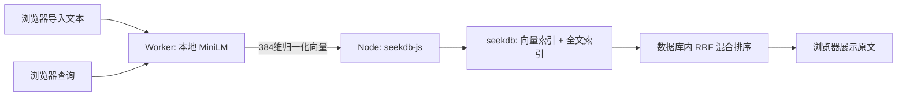

# 本地知识匣 · Stepfun × seekdb

导入英文笔记、输入自然语言问题，找到相近的原文。**文档和查询的向量都由浏览器 Worker 计算**；Node 服务只校验向量、调用 seekdb-js 存取数据。模型下载完成后，整个体验可在本机运行，不需要推理 API Key。

## 运行环境与启动

- Windows 11 + Chrome / Edge，或支持 WebGPU / WASM 的现代桌面浏览器。实测版本、CPU 与实际 GPU 适配器在 `evidence/`；WebGPU 不可用会自动使用 WASM。
- Node.js 22+、npm、Python 3.11+、Docker Engine / Docker Desktop + Compose v2。
- 建议至少 8 GB 内存和 2 GB 可用磁盘。seekdb 容器配置 2 GB 内存；浏览器模型另占内存。服务监听本机 8787，数据库监听本机 2891。
- 固定 Transformers.js 3.8.1、seekdb-js（npm 包 `seekdb`）1.4.0、seekdb 1.4.0。完整依赖见 `package-lock.json`。

在仓库的 `stepfun/` 目录运行：

```bash
npm ci --ignore-scripts
node scripts/setup.mjs
python scripts/download_models.py
docker compose -p stepfun-edge up -d
npm run build
npm start
```

打开 **http://127.0.0.1:8787**。首次启动 seekdb 需要一些时间，启动脚本会等待数据库就绪；如最终仍提示连接失败，查看 `docker compose -p stepfun-edge logs --tail=30 seekdb` 后修复配置并重试，不要删除数据卷。日常修改前端可用 `npm run dev`。

`setup.mjs` 生成本地随机数据库密码到 `.env`，已存在时保留；该文件不提交。`compose.yaml` 和 Node 服务共用这份配置。服务端只创建专用数据库 `stepfun_knowledge`，不修改其他题目的数据库。

Windows 如使用 WSL 内的独立 Docker Engine，可在 Ubuntu 中运行 Compose，Windows 运行 Node；WSL localhost 转发开启时可通过 2891 连接。保持 Ubuntu 实例运行，避免关闭后端导致本机端口不可用。此配置不要求删除 Docker Desktop 或已有数据。现有本机专用启动说明另外存于题目文件夹。

本项目显式禁用 SDK 的服务器 embedding function。`.npmrc` 的 `legacy-peer-deps` 避免安装不需要的 `@seekdb/default-embed` 可选 peer 及其 `workspace:*` 发布依赖。`--ignore-scripts` 避免无关的原生推理安装；本项目使用服务端数据库模式和浏览器 ONNX Runtime，不使用 Node embedding。

## 模型与获取方式

- 模型：[Xenova/all-MiniLM-L6-v2](https://huggingface.co/Xenova/all-MiniLM-L6-v2/tree/751bff37182d3f1213fa05d7196b954e230abad9)，Apache-2.0，384 维。上游为 `sentence-transformers/all-MiniLM-L6-v2`。
- 固定 revision：`751bff37182d3f1213fa05d7196b954e230abad9`，不跟随 main 更新。
- 使用发布方提供的 FP32 `model.onnx`、FP16 `model_fp16.onnx`、INT8 `model_quantized.onnx`。本作品采用这些公开的已转换/量化产物，不声称重新训练或自行校准了模型。
- 获取步骤由 `scripts/download_models.py` 完成：下载三个 ONNX 变体和共同 tokenizer/config，逐文件校验官方 Git blob SHA1 或 LFS SHA256，按实际文件字节数生成 `evidence/model-files.json`。不进行任何推理或预计算向量。
- `dtype:'fp16'` / `'q8'` 选择对应的已量化文件，不是运行时把任意模型“自动量化”。浏览器配置 `allowRemoteModels=false`，仅从本地 `/models/` 加载；模型本体不进入 Git。
- 下载依赖和模型需要访问 npm、Hugging Face、Docker Hub。下载属于获取文件，之后的 embedding 计算发生在浏览器 Worker，不调用这些站点的推理接口。

## 体验步骤与预期

1. 创建知识库 `my_notes`，点击“加载模型”。有可用 WebGPU FP16 适配器时显示 `WEBGPU · FP16`；否则显示 `WASM · Q8` 并说明原因。
2. 点击“导入示例语料”，导入附带的 24 篇原创英文短文。也可粘贴文本或选择多个 `.txt` / `.md` 文件；文本按最多 90 个词 / 800 字符拆块，模型最长 128 token。
3. 查询 `How can I avoid overwatering houseplants?`。应优先展示 `Plant watering` 及关于干燥表土、排水孔的原文。
4. 连续导入一条新文本，例如标题 `Project Zephyr`，正文 `Project Zephyr keeps its access code in a violet notebook. The code name is citrus comet.`。导入完成后查询 `Project Zephyr violet notebook access code`，应找到新文本。
5. 相同标题和内容再次导入，块数不增加。创建第二个空知识库再查，结果为空；切回原知识库可检索原文。刷新页面会恢复当前知识库名称。
6. 下拉选择 WASM 可手动验证 CPU 流程；自动降级的独立测试见下文。没有云模型凭据可以填写。

检索结果来自 seekdb 的实际排序，原文用 `textContent` 渲染，不执行导入文本中的 HTML。模型以英文语料为主要适用范围；中文可存储和全文检索，但不承诺该英文模型的中文语义质量。

## 数据、混合检索与状态



- SDK `Schema` 显式定义 `beng` 全文索引与 384 维 cosine HNSW 索引，`embeddingFunction:null`。每条记录包含 ID、原文、向量、标题、精度及模型 revision。
- ID 是标题和正文的 SHA256，使用 `upsert` 增量写入。正常导入批量写入后调用 `collection.refresh_index()`，底层执行 `dbms_index_manager.refresh()`；成功后才标记知识库 `ready`。失败保留 `needs_refresh`，查询被阻止，用户可点击刷新重试。重复导入不会重复计数；部分失败可用相同内容重试。
- `collection.hybridSearch()` 同时接收浏览器查询向量与全文查询，调用 `DBMS_HYBRID_SEARCH.GET_SQL` 并执行其生成的 SQL。RRF 窗口 20、常数 60；**客户端和 Node 均不获取两路结果自行融合**。
- `kb_catalog` 保存知识库状态、revision、模型版本。请求路径显式包含知识库名，界面切换时清除旧结果；导入时锁定当前目标，异步结果不会自动写入新选择的知识库。
- SDK 的混合查询使用数据库 session 变量，因此本服务对同一数据库客户端的操作排队执行，避免并发请求交错污染查询参数。这是本地演示的正确性选择，不宣称高并发吞吐。
- 正文与 ID、SQL 参数均经过校验；数据库操作使用参数绑定。只绑定 loopback，不是带用户账户和租户认证的公网产品。

## 端侧性能策略

- Worker 避免阻塞页面；优先请求高性能 WebGPU 适配器，检测 FP16 支持。不可用、初始化失败或推理失败时改用 WASM INT8，并更新界面。
- 模型在 Worker 内复用，文件可由浏览器缓存；推理结果缓存最多 512 条。基准测试关闭结果缓存，冷启动与预热后的记录分开，避免把缓存回放计为模型性能。
- 正常文档批大小 8；索引每批统一刷新。WASM 使用最多 4 线程，服务提供 COOP / COEP 头以启用共享内存。
- 比较批大小时保持模型/后端一致；比较索引策略时保持模型、批大小、语料一致。不同设备上 GPU 未必快于 CPU，本项目如实记录实际选中的适配器，不将系统装有 NVIDIA GPU 等同于已使用 NVIDIA。

## 复现实测

先启动应用，安装 Chrome 和 Edge 后运行：

```bash
npm run verify
node scripts/ui_smoke.mjs
```

脚本用独立无头浏览器执行本应用的真实前端代码，浏览器实际算向量、服务端实际写入和查询 seekdb；不使用服务端 embedding 或预先算好的结果。基准创建独立名称的知识库，不删除用户知识库。

- `public/data/corpus.json`：24 文档、12 个单相关文档标注的固定查询；仅为小型英文验证集，不代表通用语义评测。
- `evidence/browser-benchmark.json`：模型/文件获取与初始化时间、首次导入/查询、3 次重复原始记录、吞吐与各阶段中位数、Recall@3、nDCG@3、状态与降级检查。
- 获取阶段指**浏览器从本机 HTTP 服务取模型文件**，不是公网 Hugging Face 下载带宽；初始化总时间包含加载与会话编译。复用模型时为 0，文件缓存和取文件记录单独标记。
- 每轮 12 个查询重复 3 次，共 36 个热查询。端到端耗时从提交查询开始，包含浏览器向量化、HTTP、seekdb 查询、DOM 更新和两个渲染帧。
- 自动降级使用 `--disable-gpu` 启动独立 Chrome，实际 `requestAdapter()` 返回 null；不是伪造 embedding 或预置返回值。
- `evidence/edge-ui.json` / 图片：Edge 中通过按钮导入、上传文件、检索和刷新恢复。`TECHNICAL.md` 汇总最终实测。

首次运行较慢属于加载/编译成本，不应只挑最快一次；不能把本地测试通过当作赛事已给分。

## 来源

运行时及用法：[Transformers.js WebGPU](https://huggingface.co/docs/transformers.js/v3.8.1/en/guides/webgpu)、[量化 dtype](https://huggingface.co/docs/transformers.js/v3.8.1/en/guides/dtypes)。数据层：[官方 seekdb-js](https://github.com/oceanbase/seekdb-js)、[seekdb Docker 镜像](https://github.com/oceanbase/docker-images/tree/main/seekdb)。模型来自上述固定 Hugging Face revision；界面、业务代码、语料和测试脚本为本题实现。
